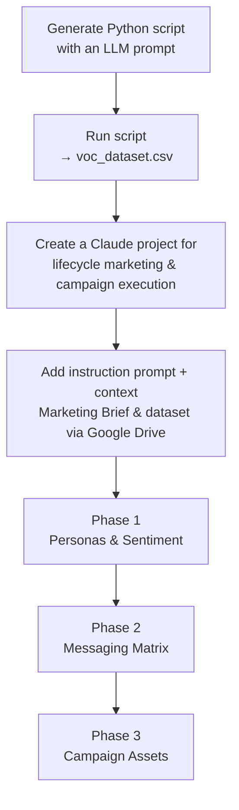
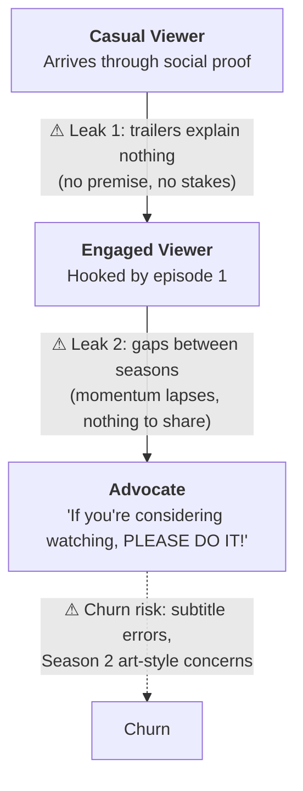

# voc-lifecycle-ai-project
A portfolio to demonstrate an AI project for marketing professionals

**Author:** Ja'Lisa Little

An AI workflow that turns raw audience comments into behavioral personas, a messaging strategy, and a complete multi-channel marketing campaign, and can be rerun every season or product launch without starting over.

> **Disclaimer:** This is an independent case study built to demonstrate a brand-agnostic Voice-of-Customer (VoC) to campaign workflow. It is not affiliated with or endorsed by Crunchyroll. *Jujutsu Kaisen* is used only as a proof of concept.

---

## TL;DR

| | |
|---|---|
| **Problem** | Audience expectations shift during the long gaps between seasons, and traditional social listening is a one-time snapshot that is expensive to repeat. |
| **Solution** | A Python scraper collects audience comments, and a three-phase Claude workflow turns them into personas, a messaging matrix, and ready-to-launch campaign assets. |
| **Case study** | 583 YouTube comments on *Jujutsu Kaisen* (JJK) trailers, split into a **baseline** (Season 1) and **recent** (Season 2) segment. |
| **End result** | 3 lifecycle personas, a 4-stage messaging matrix, and **9 launch assets** (3 ads, 3 emails, 3 community prompts), each traced back to the comments it's built on. |
| **Key insight** | The biggest acquisition blocker wasn't lore complexity, as the brief assumed. It was **trailers that don't explain what the show is.** |

---

## Table of contents

1. [Business case](#1-business-case)
2. [How the workflow works](#2-how-the-workflow-works)
3. [Repository structure](#3-repository-structure)
4. [Step 0: Data collection (Python)](#4-step-0-data-collection-python)
5. [Phase 1: Personas & sentiment](#5-phase-1-personas--sentiment)
6. [Phase 2: Messaging matrix](#6-phase-2-messaging-matrix)
7. [Phase 3: Multi-channel campaign assets](#7-phase-3-multi-channel-campaign-assets)
8. [Results at a glance](#8-results-at-a-glance)
9. [Limitations & next steps](#9-limitations--next-steps)
10. [Definitions](#10-definitions)

---

## 1. Business case

Years can pass between anime seasons, and audience intent shifts in that time. Traditional social listening captures one moment and is costly to repeat. This workflow is built to be **rerun each season or for any new product launch** with minimal rework.

It addresses three problems:

- **Long gaps reshape audience intent.** What fans wanted at Season 1 isn't what they want at Season 2.
- **Signals are buried.** Useful insight is scattered across thousands of unstructured comments.
- **Manual social listening doesn't scale.** It's slow, expensive, and hard to repeat consistently.

**Goal:** Drive viewership growth, community engagement, and revenue by grounding every campaign decision in what the audience actually says.

---

## 2. How the workflow works



Each phase uses the output of the one before it, and you review the output after every phase before moving on.

| Step | Input | Output |
|---|---|---|
| **0. Data collection** | YouTube trailer URLs | `voc_dataset.csv` (583 comments) |
| **1. Personas & Sentiment** | Dataset + Marketing Brief | 3 lifecycle personas, transition map, sentiment drift signals |
| **2. Messaging Matrix** | Phase 1 output | Trigger, channel, value proposition, and metric for each lifecycle transition |
| **3. Campaign Assets** | Messaging Matrix + Brand Voice | 9 launch-ready assets |

**By the numbers:** 1 Python script · 583 YouTube comments · 2 segments (baseline & recent) · 4 prompts (1 data + 3 phases) · 9 launch assets · 2 creative mockups

---

## 3. Repository structure

```
.
├── README.md
├── data-collection/
│   ├── voc_collector.py         # Scrapes and normalizes YouTube comments
│   └── requirements.txt
├── data/
│   └── voc_dataset.csv          # 583 rows × 6 columns
├── context/
│   └── marketing_brief.md       # Brand voice, positioning, business objectives
├── prompts/
│   ├── 00_python_script.md
│   ├── 01_personas_sentiment.md
│   ├── 02_messaging_matrix.md
│   └── 03_campaign_assets.md
├── outputs/
│   ├── 01_personas_sentiment.md
│   ├── 02_messaging_matrix.md
│   └── 03_campaign_assets.md
└── docs/
    └── AI_Project_deck.pdf      # Original presentation
```

### Run it yourself

```bash
pip install -r data-collection/requirements.txt
python data-collection/voc_collector.py
```

Then create a Claude project, add `context/marketing_brief.md` and `data/voc_dataset.csv` as project knowledge, and paste the prompts from `prompts/` in order.

---

## 4. Step 0: Data collection (Python)

**Prompt summary:** Act as a Senior Data Engineer and write a Python script that collects public audience comments from YouTube and normalizes them into a single CSV for downstream LLM persona analysis.

- Uses [`youtube-comment-downloader`](https://pypi.org/project/youtube-comment-downloader/) to fetch top comments sorted by popularity
- Pulls up to 500 comments per trailer URL
- Labels Season 1 trailer comments as **baseline** and Season 2 trailer comments as **recent**

**Output:** `voc_collector.py` and `requirements.txt`. Running the script produces `voc_dataset.csv`.

**Schema (583 rows × 6 columns)**

| Column | Description |
|---|---|
| `comment_id` | Unique comment identifier |
| `cohort` | `baseline` (Season 1) or `recent` (Season 2) |
| `source` | Where the comment came from (YouTube video) |
| `date` | Comment date |
| `engagement_score` | The comment's like count |
| `raw_text` | Comment text |

---

## 5. Phase 1: Personas & sentiment

**Inputs:** Marketing Brief, `voc_dataset.csv`

**Prompt summary:** Analyze the dataset and brief to build detailed personas across three lifecycle stages: Casual Viewer, Engaged Viewer, and Advocate. For each persona, define core motivations, viewing habits, pain points, and the language they use in comments.

### Results: baseline segment (220 comments)

| Lifecycle stage | Signals in comments | Comments | Total likes |
|---|---|---:|---:|
| **Casual Viewer** | "know nothing," "worth watching?", trailer confusion, first-time viewer | 32 | 104 |
| **Engaged Viewer** | Episode-level reactions, season countdowns, studio hype, "hooked" | 42 | 6,692 |
| **Advocate** | Manga knowledge, arc names, VA/staff credits, spoiler policing, OST hunting, character rankings | 53 | 6,268 |
| Unassigned | None of the above | 93 | 2,586 |

### Lifecycle transition map & sentiment drift

*Sentiment drift* is the gradual shift in how an audience perceives and talks about a brand or product over time. The workflow found two places where viewers drop off:



**Key finding:** Lore complexity, which the brief assumed was the top barrier, barely shows up in the comments. The real blocker is **trailers that fail to explain the show.**

---

## 6. Phase 2: Messaging matrix

**Input:** Phase 1 output

**Prompt summary:** Build a messaging matrix that moves a Casual Viewer to Advocate. For each lifecycle transition, map the psychological trigger, primary marketing channel, core value proposition, and conversion metric.

**Strategy in one line:** Win new viewers with clear, character-led clips, keep them watching with a weekly ritual, and let advocates' content feed the next round of acquisition.

| Transition | Psychological trigger | Primary channel |
|---|---|---|
| **Casual → Engaged** | **Social proof and clarity.** Viewers start when "everyone's talking" and drop off when a trailer doesn't say what the show is. New characters drive the most-liked recent comments. | **Paid social** (TikTok, Instagram Reels/Stories): 15–30s cuts led by one character, dub audio, premise in the first 3 seconds, no lore. |
| **Engaged → Advocate** | **Weekly ritual and fear of missing the conversation**, then something to share. Season gaps break the habit. | **Lifecycle CRM email**: weekly episode-day reminder and lapsed-viewer flow, each with one shareable clip. Lapsed viewers get a 20-second catch-up, not a recap. |
| **Advocate → Recruiter** | **Status, insider access, and credit for their work.** Advocates already recruit, quote lore, and follow VAs. Churn risk: translation slips. | **Organic community** (Reddit, X, TikTok/YouTube Shorts): edit kits (soundtrack stems, key frames), VA and staff spotlights, spoiler-tagged theory threads. |
| **Advocate → new Casual Viewers** | **Peer trust beats brand ads.** One viewer gave up after the trailer but started because a friend pushed them. | **UGC and word of mouth**: best fan edits and community conversations. |

> The full matrix, including core value proposition and conversion metric for each row, is in [`outputs/02_messaging_matrix.md`](outputs/02_messaging_matrix.md).

---

## 7. Phase 3: Multi-channel campaign assets

**Inputs:** Messaging Matrix, Brand Voice (from the Marketing Brief)

**Prompt summary:** Act as a Senior Lifecycle & Growth Copywriter and generate a complete multi-channel campaign for a new season, covering acquisition, engagement, and advocacy.

**Output: 9 assets, one per stage of the messaging matrix**

| Goal | Assets | Purpose |
|---|---|---|
| Acquisition | 3 paid social ads | Make the show easy to start |
| Engagement | 3 lifecycle emails | Win back lapsed viewers before premiere night |
| Advocacy | 3 community prompts | Turn watchers into recruiters |

Each asset lists the VoC comments it's built on and the matrix metric it moves, so every creative decision is traceable to real audience language. Full assets are in [`outputs/03_campaign_assets.md`](outputs/03_campaign_assets.md).

---

## 8. Results at a glance

- **A corrected assumption.** The brief assumed lore complexity was the main barrier, but the data showed it was trailer clarity. That one finding reshapes the whole acquisition strategy.
- **Two drop-off points identified:** before episode 1 (unclear trailers) and between seasons (lost momentum).
- **A full campaign from raw comments:** personas → messaging → 9 launch-ready assets, produced in four prompts.
- **Repeatable.** Swap in new URLs and a new brief, and the same workflow runs for the next season or a different product.

---

## 9. Limitations & next steps

| Area | Limitation | Next step |
|---|---|---|
| **Data source** | Only YouTube comments. Reddit was attempted but blocked by API restrictions. | Get a MyAnimeList API Client ID for a broader range of commentary. |
| **Audience coverage** | Trailers analyzed were subtitled only. | Add English-dub trailers to compare sub vs. dub audiences. |
| **Testing** | Tested on one personal-interest case. | Test across other products and industries to gauge output quality. |
| **Manual input** | The Marketing Brief is written by hand from existing brand knowledge. | Have AI draft the brief, then reference it in Phase 1. |

---

## 10. Definitions

**Lifecycle stages**

| Stage | Profile | Pain points |
|---|---|---|
| **Casual Viewer** | Watches intermittently, prefers the English dub, enjoys action and cool characters, often waits until a season finishes or catches up via clips. | Overwhelmed by long gaps between seasons, complex power explanations, or sudden dark tonal shifts. |
| **Engaged Viewer** | Watches weekly during simulcast, invested in character arcs and animation quality, discusses episodes in group chats. | Needs consistent community momentum and behind-the-scenes hype to go from passive viewer to active promoter. |
| **Advocate** | Deeply invested in lore and voice-actor performances, active on Reddit/X/TikTok, creates and shares edits and theories, buys merchandise, recruits friends. | Risks burnout or frustration if localization quality dips or pacing feels rushed; thrives on shareable "insider" assets. |

**Other terms**

- **Cohort:** The segment a comment belongs to. Season 1 comments are **baseline**; Season 2 comments are **recent**.
- **Engagement score:** The like count of an individual comment.
- **Sentiment drift:** The gradual shift in how an audience perceives and talks about a brand, product, or topic over time.
- **VoC (Voice of Customer):** Direct audience feedback, in this case public comments, used as the input for strategy.
